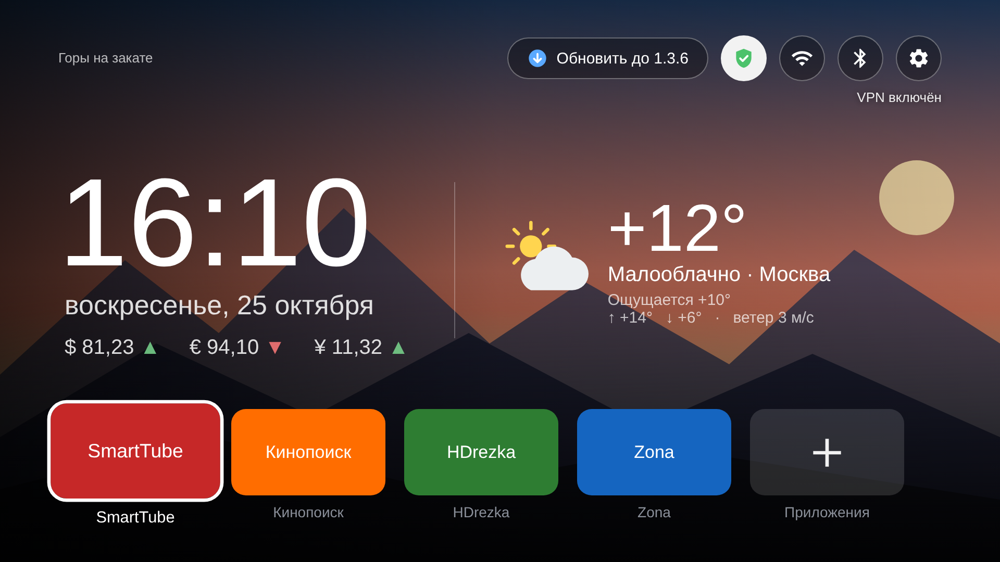
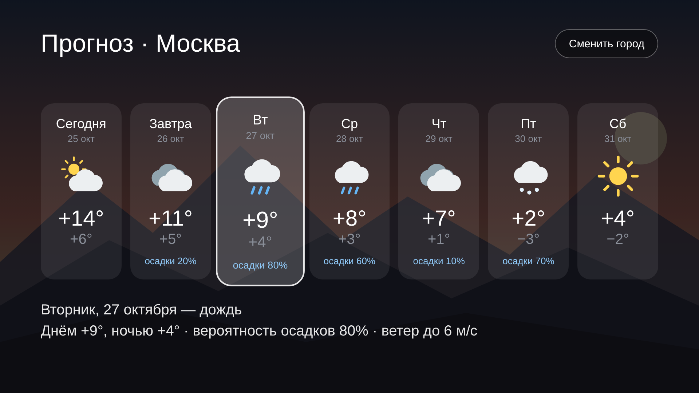

# Мой лаунчер для Android TV

Минималистичный главный экран для Xiaomi TV Stick (Google TV) без рекламы и рекомендаций:
часы по центру, погода, статичный фон в стиле macOS, кнопка VPN и только нужные приложения.





> Картинки — макеты в разрешении телевизора (1920×1080), нарисованные по разметке
> лаунчера. Фон — тот же статичный рисунок, что встроен в лаунчер.

## Что умеет

- **Часы и дата по центру**, как на экране блокировки iOS.
- **Погода** с иконками: температура, «ощущается как», максимум/минимум за день, ветер.
  Ночью — иконки с луной.
- **Прогноз на 7 дней** — по «ОК» на погоде. Подробности по выбранному дню, смена города.
- **Статичный фон в стиле macOS** — свой рисунок, встроен в лаунчер, без интернета.
- **Кнопка VPN**: значок показывает, включён ли VPN, «ОК» включает или выключает Happ,
  не открывая его.
- **Избранные приложения**: порядок и состав настраиваются с пульта.
- **Быстрые кнопки** Wi-Fi, Bluetooth, Настройки.
- **Автообновление**: новая версия с GitHub ставится кнопкой на главном экране.
- **VPN по приложениям**: для каждой плитки — «включать VPN», «выключать VPN» или «не менять»;
  лаунчер переключит Happ перед запуском. Щит на плитке показывает правило.
- **Таймер сна**: 15 мин – 2 ч, предупреждение за минуту, потом приставка засыпает (через отладку по сети).
- **Ночной режим**: с 23:00 до 7:00 фото и текст приглушены.
- **Очистка памяти**: закрывает фоновые процессы и показывает, сколько освободилось (через отладку по сети).
- **Индикатор интернета**: полоски зелёные / жёлтые / красные по задержке; по «ОК» — замер скорости.
- **Заставка**: тот же фон, часы и погода по центру, ночью приглушена, без выгорания экрана.

## Управление с пульта

| Где | Действие |
|---|---|
| Плитка приложения | **ОК** — открыть; **долгое ОК** — сдвинуть влево/вправо, убрать, «О приложении» |
| Плитка «Приложения» | Отметить, какие приложения показывать на главном экране |
| Погода | **ОК** — прогноз на неделю; **долгое ОК** — сменить город |
| Круглые кнопки вверху | VPN (щит: зелёный — включён, серый — выключен), интернет (полоски), таймер сна (луна), очистка памяти, Google Play, Wi-Fi, Bluetooth, Настройки |
| Долгое ОК на плитке → «VPN при запуске» | Включать / выключать / не менять VPN для этого приложения |
| «Обновить до …» | Скачать и установить новую версию (появляется сама) |
| «Назад» на главном экране | Ничего не делает — это главный экран |

## Что изменилось с первой версии

Первая версия (1.0) была тёмным экраном с часами, датой, строкой избранных приложений
и одной строкой погоды вверху. С тех пор:

**1.1 — фон, курсы, надёжная погода**
- Фото дня Bing на фоне главного экрана, обновляется раз в сутки и хранится на устройстве.
- Затемнение слева и снизу, полупрозрачные кнопки — текст читается на любом фото.
- Курсы ЦБ РФ (USD, EUR, CNY) под датой, с цветными стрелками изменения.
- Запасной источник погоды (wttr.in), если Open-Meteo недоступен; ошибки пишутся в лог.
- Единый цикл обновления данных с автоповтором после сбоев.

**1.2 — новый блок погоды**
- Погода переехала из верхней строки в отдельную карточку справа от часов —
  больше не пересекается с подписью к фото.
- Свои векторные иконки: ясно, малооблачно (день/ночь), облачно, туман, дождь, снег, гроза.
- Крупная температура, «ощущается как», максимум/минимум за день, ветер.

**1.3 — VPN, прогноз, автообновление**
- Кнопка VPN со значком состояния (зелёный — включён, серый — выключен, жёлтый — переключается).
  Состояние берётся у системы, переключение — через команды Happ
  `happ://connect_without_ui` / `happ://disconnect_without_ui`.
- Экран прогноза на 7 дней (на 3 дня, если работает только запасной источник).
- Смена города переехала в прогноз и на долгое «ОК» по погоде.
- Самообновление: GitHub Actions публикует `tv-launcher.apk` и `version.json`
  в релиз `latest`, лаунчер проверяет его при каждом нажатии «Домой» и раз в 5 минут и предлагает обновиться.
- Номер версии теперь берётся из номера сборки GitHub Actions.

**1.3.5 — круглые кнопки**
- VPN, Wi-Fi, Bluetooth и Настройки — маленькие круглые кнопки с иконками вместо текстовых.
- Под ними подпись кнопки в фокусе («VPN включён», «Wi-Fi»…).
- Первое обновление, которое приходит на телевизор само, кнопкой «Обновить до …».

**1.3.6 — текстовые плитки**
- Плитки приложений — только название в полупрозрачной «таблетке», без баннеров и иконок;
  в фокусе белая с тёмным текстом. Такие же плитки на экране выбора приложений.
- Проверка обновлений на GitHub — каждые 5 минут, пока открыт главный экран, и при возврате на него.

**1.3.7 — VPN по приложениям, сон, ночь, память**
- Правило VPN для каждого приложения (долгое «ОК» на плитке): лаунчер переключает Happ,
  ждёт, пока VPN включится или выключится, и только потом открывает приложение.
  Зелёный или серый щит на плитке показывает правило.
- Таймер сна (кнопка с луной): 15, 30, 45 мин, 1, 1,5, 2 ч; за минуту — предупреждение,
  затем приставка засыпает (через root, по HDMI-CEC обычно выключается и телевизор).
  Пока таймер идёт, луна жёлтая, а подпись показывает, сколько осталось.
- Ночной режим с 23:00 до 7:00: фото и интерфейс приглушены.
- Очистка памяти (кнопка с метлой): `am kill-all` через root, активный VPN не трогается;
  показывает, сколько памяти освободилось.

**1.3.8 — заставка и индикатор интернета**
- Своя заставка: фото Bing за последние 8 дней, смена каждые 40 секунд с плавным переходом
  и медленным приближением; часы, дата и последняя погода; ночью приглушена;
  часы понемногу смещаются, чтобы не выжигать экран.
- Индикатор интернета: время соединения с ya.ru раз в 5 минут — до 80 мс зелёный,
  до 200 мс жёлтый, дальше или нет сети — красный; в подписи видно, идёт ли трафик через VPN.
- Замер скорости по «ОК» на индикаторе: ~10 секунд загрузки (Cloudflare, запасной — Selectel).

**1.3.9 — проверка обновлений по «Домой»**
- Нажатие «Домой» на пульте (и возврат на главный экран из приложения) сразу проверяет
  GitHub на новую версию; между проверками не меньше 15 секунд. Плюс, как раньше, раз в 5 минут.

**1.3.13 — без root**
- Таймер сна и очистка памяти работают без root: через отладку по сети на самой приставке
  (библиотека [dadb](https://github.com/mobile-dev-inc/dadb)); root используется, только если он есть.
- Понятные сообщения: «включите отладку по сети», «подтвердите запрос на экране».

**1.3.14 — Земля из космоса**
- Источник фото — Google Earth View вместо Bing: ~1500 спутниковых снимков (гор, рек, пустынь, островов).
- Главный экран: снимок дня — каждый день новый, без повторов несколько лет.
- Заставка: до 30 снимков на устройстве, раз в 6 часов докачиваются 6 новых случайных;
  в углу подпись места («Исландия · Google Earth»).
- Названия стран переводятся на русский.

**Дизайн в стиле iOS**
- «Стеклянные» карточки: тёмный полупрозрачный материал, тонкая светлая кромка, крупное скругление.
- Часы как на экране блокировки iOS: дата сверху, под ней крупное время.
- Погода и курсы ЦБ — виджеты-карточки справа; погода в формате «Макс.: …, мин.: …».
- Приложения — в «доке» по центру внизу; фокус как на Apple TV: плитка приподнимается и увеличивается.
- Системные цвета iOS для индикаторов (зелёный, жёлтый, красный, синий), тёмные скруглённые диалоги.

**1.3.16 — легче и проще**
- Часы по центру, под ними погода одной «стеклянной» строкой; курсы валют убраны.
- Вместо снимков Earth View — один статичный фон в стиле macOS (свой рисунок, 68 КБ, без сети);
  заставка — тот же фон с часами по центру.
- Облегчение: картинки приложений не грузятся в память, фон декодируется в половинном
  разрешении (~1 МБ вместо ~8 МБ), код и ресурсы сжимаются R8; при запуске удаляются
  скачанные раньше снимки (~15 МБ) и старый файл обновления.
- `tools/optimize.ps1` — ускорение системы: анимации ×0.5, заморозка фоновых приложений,
  отключение лишних сервисов Xiaomi и Google, очистка кэшей, оптимизация приложений.

**1.3.18 — новый фон**
- Фон и заставка — натюрморт «банан и два яйца» на тёмно-синем фоне (свой рисунок, 48 КБ).

**Кнопка Google Play**
- Кружок с сумкой открывает Play Маркет: на Google TV у него нет своего значка,
  а стандартный лаунчер Google TV отключён. Если Маркет отключён — лаунчер сам включит его.

## Ускорение системы

Скопируйте `tools/optimize.ps1` в папку с adb и выполните:

```powershell
powershell -ExecutionPolicy Bypass -File .\optimize.ps1
```

Всё обратимо: `.\adb shell pm enable <пакет>`; анимации — те же команды со значением `1`.

## Включить заставку

На Google TV выбор сторонних заставок в настройках скрыт, поэтому один раз через adb:

```powershell
.\adb shell settings put secure screensaver_components ru.my.tvlauncher/.ScreensaverDream
.\adb shell settings put secure screensaver_enabled 1
```

Время до включения — в «Настройки → Система → Энергосбережение / Заставка».

## Доступ для таймера сна и очистки памяти

Этим функциям нужны права shell. Root не обязателен: лаунчер подключается к
«Отладке по сети» на самой приставке (127.0.0.1:5555), как adb с компьютера.

1. «Для разработчиков» → «Отладка по сети» должна быть включена.
2. При первом нажатии на луну или метлу на экране появится «Разрешить отладку?» —
   отметьте «Всегда разрешать с этого компьютера» и нажмите «ОК».

Если на приставке есть настоящий root (Magisk), лаунчер сначала попробует его.
На некоторых прошивках отладка по сети выключается после перезагрузки — тогда её
нужно включить снова.

## Сборка

GitHub Actions собирает APK при каждом push в `main` и выкладывает его в релиз
[`latest`](../../releases/tag/latest) вместе с `version.json`.

## Установка (первый раз)

Нужен включённый «Отладка по сети» на приставке и
[Android platform-tools](https://developer.android.com/tools/releases/platform-tools) на компьютере.

```powershell
.\adb connect <IP-приставки>:5555
.\adb install -r tv-launcher.apk
.\adb shell appops set ru.my.tvlauncher REQUEST_INSTALL_PACKAGES allow
.\adb shell cmd package set-home-activity ru.my.tvlauncher/.MainActivity
```

Третья команда разрешает лаунчеру ставить собственные обновления.
Дальше обновления приходят кнопкой «Обновить до …» на главном экране.

Если кнопка «Домой» всё равно открывает Google TV:

```powershell
.\adb shell pm disable-user --user 0 com.google.android.apps.tv.launcherx
```

Вернуть как было: `.\adb shell pm enable com.google.android.apps.tv.launcherx`.

## Источники данных

- Погода: [Open-Meteo](https://open-meteo.com/), запасной — [wttr.in](https://wttr.in/)
